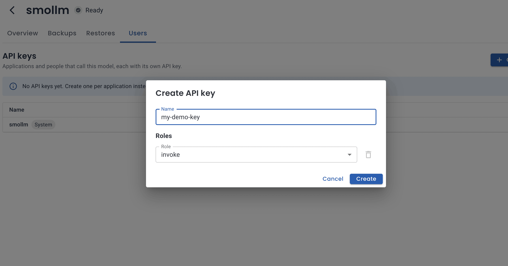
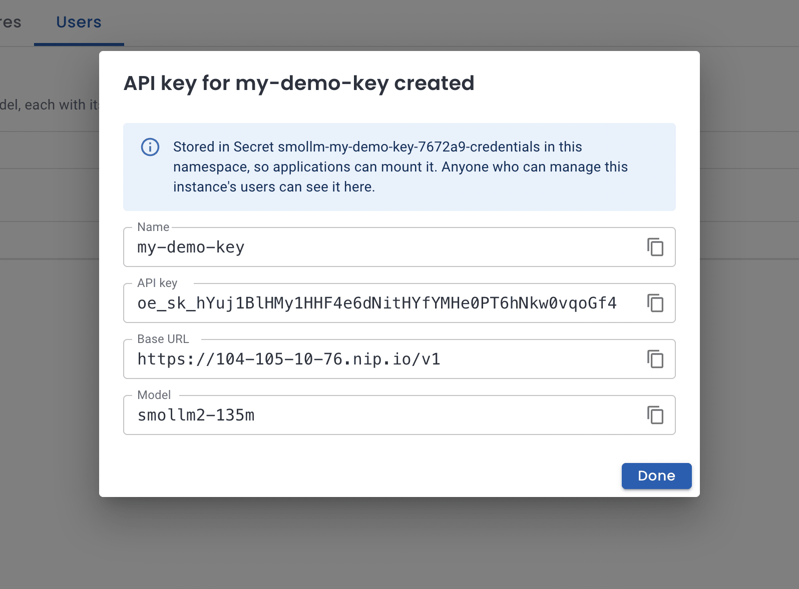
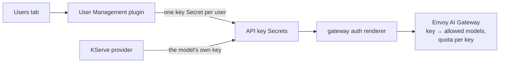

In [Model-as-a-Service with OpenEverest](https://solanica.io/blog/model-as-a-service-with-openeverest/) every model got one API key. The KServe provider generated it, kept it for the life of the model and showed it in the connection details, just like a database password.

That's fine for a demo. In real life it hurts in the same ways a shared admin password does:

- **Everyone shares it.** The chat app, the nightly batch job and three developers' notebooks all send the same key.
- **A leak means rotating it for everyone.** One key pasted into the wrong Slack channel breaks every client at once.
- **Quotas and metrics can't tell consumers apart.** The token quota is a budget for the whole model, and "who burned the GPU budget this week" has only one answer: the model.

We already had a fix for exactly this problem, just for databases.

## A key is just a user of a model

The [User Management plugin](https://github.com/openeverest/plugin-user-management) adds a *Users* tab to MongoDB and PostgreSQL instances, so teams stop sharing the admin account. Each user is an `InstanceUser` resource; the plugin creates it in the database, keeps its credentials in a Secret your application can mount, and drops it when you delete it.

A consumer of a model is the same thing. So instead of building a new API, we taught the plugin a new engine: `provider-kserve`. Open a model, go to *Users*, and you'll see *API keys* instead of database users:



Click *Create API key*, give it a name (`chat-app`, `team-search`, `alice`...), and you get everything a client needs:

- **API key:** `oe_sk_...`, always generated, never typed.
- **Base URL:** `https://<your-gateway>/v1`.
- **Model:** the name to send in the `model` field.



It's stored in a Secret in the model's namespace, so an application can mount it instead of copying it around. Any OpenAI-compatible client works:

```bash
curl https://<your-gateway>/v1/chat/completions \
  -H "Authorization: Bearer $KEY" \
  -H 'Content-Type: application/json' \
  -d '{"model":"qwen3-4b","messages":[{"role":"user","content":"Explain Kubernetes in one sentence."}]}'
```

Prefer GitOps? It's a few lines of YAML:

```yaml
apiVersion: plugin-user-management.plugins.openeverest.io/v1alpha1
kind: InstanceUser
metadata:
  name: chat-app
  namespace: team-a
spec:
  instanceRef:
    name: qwen-small      # the model Instance
  username: chat-app
  roles:
    - role: invoke
```

## What you get per key

We tried every case below on a test cluster with small CPU models, then ran Qwen3-4B on a GPU behind the Envoy AI Gateway with a Let's Encrypt certificate and called it with a per-application key. Each key lives its own life:

- **Rotate API key.** The old key is rejected within about a second, and the new one works right away. Nobody else notices.
- **Delete.** Only that key stops working.
- **Token quota.** `tokenLimitPerHour` is counted per key and model. One key ran into `429` while another key on the same model kept going.
- **Metrics.** Gateway GenAI metrics carry an `openeverest_key_id` label, so token usage splits per application.
- **Other models.** A key only calls the model it was created for; anything else gets `403`.
- **Delete the model.** Its keys go with it.

The model's own key is still there, listed as a *System* user. Existing clients keep working while you move them to their own keys.

## How it works

The KServe provider already had everything needed on the request path. Its gateway auth renderer collects every API key Secret, in the cluster, that follows a simple format: a key value, a key ID, and the models it may call. It turns them into one Envoy Gateway `SecurityPolicy`. Envoy checks the key, the AI Gateway reads the model from the request body, and an authorization rule allows each key only its models. The plugin simply writes more of those Secrets:



Because the renderer, the request flow and the client contract didn't change, per-key quotas and per-key metrics came for free: they were already keyed by key ID, there just used to be one key per model.

Opening that format to other writers meant closing a hole first. The renderer used to trust whatever models a key Secret listed, so anyone able to create a Secret in *any* namespace could grant themselves *any* model on the shared Gateway. Now:

- **A key only reaches models in its own namespace.** Writing a key Secret in a namespace gives you nothing that namespace's Secrets didn't already give you.
- **Collisions fail closed per key.** If two keys share an ID or a value, Envoy Gateway rejects the whole policy, and every model on the Gateway goes down with it. The renderer now leaves out just the colliding keys and logs it. The plugin also uses random key IDs, and the Users tab and its API never accept a typed key.
- **Same permissions as databases.** Managing a model's keys requires the `read-connection` permission on the model, the same rule as for database users: whoever can read the model's own key could already call it.

The details are in the provider's [API keys proposal](https://github.com/openeverest/provider-kserve/blob/main/docs/proposals/ai-gateway-api-keys.md).

## Try it

You need *provider-kserve 0.4.4* or later with the AI Gateway enabled (the [setup guide](https://github.com/openeverest/provider-kserve/blob/main/docs/ai-gateway-setup.md) walks through it, including `nip.io` and Let's Encrypt for tests), and *plugin-user-management 0.2.0* or later:

```bash
helm install plugin-user-management \
  oci://ghcr.io/openeverest/charts/plugin-user-management \
  --version 0.2.0 --namespace everest-system
```

Deploy a model with `externalAccess: EnvoyAIGateway`, open its *Users* tab, and create a key per application.

## What's next

Keys today belong to one model. The next step is a personal key that works across all the models a person can use, with a mandatory expiry, since nothing tells OpenEverest when someone leaves the team. It's sketched in the same proposal, and we'd love to hear how you'd use it.

* **Plugin:** [openeverest/plugin-user-management](https://github.com/openeverest/plugin-user-management)
* **KServe provider:** [openeverest/provider-kserve](https://github.com/openeverest/provider-kserve)
* **Chat:** Join the conversation in the CNCF Slack (channel: [#openeverest-users](https://cloud-native.slack.com/archives/C09RRGZL2UX)).
